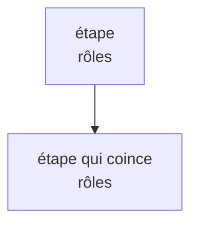

# @vaubanhq/restitution

Moteur de composition des restitutions : un Markdown à grammaire fermée devient un document A4 mis en page avec le design system. Trois usages, un seul code :

- **dans le navigateur**, chargé par l'artefact de l'assistant de la personne (`dist/browser/restitution.js`, servi par jsdelivr) ;
- **côté serveur**, importé par l'application pour valider une remise et composer un export (`dist/node/index.js`) ;
- **avec une autre charte** (logo, couleurs, police, motif) : la charte est une donnée, les compositions sont du code.

Code propriétaire (UNLICENSED), publié pour être chargé par les applications de Vauban et de ses clients : aucune réutilisation, copie ni modification sans accord écrit (voir `LICENSE`).

URL CDN : `https://cdn.jsdelivr.net/npm/@vaubanhq/restitution@0.2.1/dist/browser/restitution.js` (jsdelivr sert le paquet npm). L'URL `/gh/` de jsdelivr (`https://cdn.jsdelivr.net/gh/BESSON-AGENCY/vauban-restitution@v0.2.1/dist/browser/restitution.js`) n'est pas chargeable par un artefact : le bac à sable n'accepte que `/npm/`.

## Le document minimal d'un artefact

```html
<!doctype html><html lang="fr"><head><meta charset="utf-8"><meta name="viewport" content="width=device-width,initial-scale=1"><title>…</title></head><body><script type="text/markdown" id="restitution">…le Markdown…</script><script src="https://cdn.jsdelivr.net/npm/@vaubanhq/restitution@0.2.1/dist/browser/restitution.js"></script></body></html>
```

Le chargeur lit le script `#restitution` (le Markdown peut être indenté dans la page), le lit selon la grammaire, compose avec `VAUBAN_CHARTE` (ou la charte posée dans `window.RESTITUTION_CHARTE` avant le chargeur), injecte le HTML et le CSS, charge la police (Jost, avec repli système) et, s'il y a un schéma à dessiner, Mermaid 11.12.0 depuis cdnjs (avec contrôle d'intégrité SRI sha384, `scripts/sri.mjs`). Si le Markdown sort de la grammaire, la page affiche la liste des refus (ligne et raison) au lieu du document.

Sans script (un canevas qui n'exécute rien), rien ne s'affiche : le repli est le Markdown dans la conversation.

## La grammaire

Chaque `## Titre {genre}` ouvre une rubrique. Les rubriques courtes s’enchaînent sur la même page ; le navigateur mesure leur place après le chargement des polices et le rendu des schémas. La couverture reste isolée, et `---` impose un saut de page. Le genre vient d'un catalogue fermé ; tout ce que la grammaire ne nomme pas est refusé avec sa ligne.

````
# Titre du document
23 octobre 2026 · Prénom
Pour Prénom, Organisation          (facultatif)
Une phrase d'objectif.             (facultatif)

## Ce que vous m'avez dit {recit}
Un paragraphe (le premier est le chapeau). **gras** et *italique* seulement.

> « une phrase entière d'elle, en exergue »

- « **Trois jours** perdus » sur les validations client.

**Une phrase de conclusion de page, tout en gras.**

---                          (saut de page sans titre)

## Vos cas {cas}
### Un cas                    (reste avec son contenu si la place le permet)

````

| Genre | Porte | Composition |
|---|---|---|
| `recit` | un récit, des exergues, des chiffres, des `###` intertitres sur la même page (synthèse) | `vd-text`, `vd-pullquote`, `vd-figure` |
| `cas` | des cas déroulés (`###`), schéma ou ligne `→` | `vd-subheading`, Mermaid, `vd-journey` pour la ligne `→` |
| `chiffres` | des chiffres, chacun dans sa phrase | `vd-figure-group` |
| `frise` | des épisodes datés (`timeline`) | Mermaid |
| `carte` | ses sujets autour d'elle (`mindmap`) | Mermaid |
| `journee` | une journée type (`flowchart`, ou `journey` avec scores) | Mermaid |
| `avant-apres` | un tableau à 2 colonnes | `vd-comparison` |
| `tableau` | un tableau à colonnes | `vd-table` |
| `lecture` | `## Ce que je comprends de vos cas {lecture}`, ouvert de préférence par `Voici ma lecture de vos cas. Vous pouvez la corriger.` | `vd-callout` |
| `reste` | `## Ce que nous n'avons pas abordé {reste}`, liste de `- « … »` | `vd-next-steps` sur fond nuit |

Un chiffre dit se lit comme du texte : la ligne entière à la taille du chapeau, le nombre en bleu. L'exergue est à 24 px.

Tous les schémas passent par Mermaid, avec un thème tiré de la charte : flowcharts (déroulés, avec leurs branches et leurs boucles), timelines (frises), carte et parcours. L'étape marquée `class X coince` ressort dans la couleur d'accent de la charte (le moteur pose lui-même la `classDef`, celle de l'assistant est ignorée). Sans Mermaid, le texte de secours de chaque schéma reste affiché. Le titre d’une rubrique reste avec son premier contenu. Un cas ou une rubrique qui tient sur une page vide avec ses titres reste entier : il passe à la suivante seulement s’il ne tient plus dans la place disponible. Un cas plus long continue entre ses paragraphes ; les titres qui le précèdent sont comptés dans la place nécessaire. Les deux derniers paragraphes restent ensemble si leur place le permet, pour éviter une fin de récit isolée avant un schéma. Une longue rubrique continue entre paragraphes, éléments de liste ou lignes de tableau ; un déroulé textuel continue entre ses étapes, une table reprend son en-tête et la lecture conserve son encadré. Le dernier bloc garde son fond nuit sous forme d’encadré, sans imposer une page à lui seul. Les pieds de page et libellés accessibles sont renumérotés après la mesure.

La liste complète des refus est dans `test/grammar.test.ts`.

## Côté serveur

```ts
import { parse, compose, validate, VAUBAN_CHARTE, formatRefusal } from '@vaubanhq/restitution';

const result = parse(markdown);                 // { ok, document, refusals }
if (!result.ok) console.log(result.refusals.map(formatRefusal));
const html = compose(result.document, VAUBAN_CHARTE);   // page HTML autonome
const refusals = validate(markdown, frame);     // frame facultative : suite et titres des blocs d'un modèle
```

`composeParts(document, charte)` rend `{ css, html, fontsHref, script, mermaidScript, pageCount }` pour insérer le document dans une autre page. Le nombre `pageCount` est celui de la composition initiale (couverture et sauts explicites) ; le script mesure ensuite les pages finales à l’écran ; l’impression A4 reprend ces pages après la fin de cette mesure. `data-vr-ready="1"` sur la racine HTML signale la fin de la mesure. Un élément indivisible plus haut qu’une page conserve son texte et son titre, et sa page porte `data-vr-overflow="1"` : il demande une correction de la matière, pas une réduction de la taille de lecture. Aucune dépendance, aucun DOM dans le parseur ni dans les compositions.

## La charte

```ts
interface Charte {
  name: string;
  logo: string;                       // <svg viewBox=…> en currentColor
  fonts: { stylesheet: string | null };
  tokens: Record<string, string>;     // propriétés --ds-* du design system
  motif: string;                      // <svg> du motif de couverture
}
```

Aucune valeur de charte n'est écrite dans les compositions ni dans le CSS : tout passe par `:root{…}`. `assertCharte` refuse une charte inutilisable (jeton manquant, couleur qui n'est pas en hexadécimal, script dans le SVG). `test/compose.test.ts` compose avec une charte factice et vérifie qu'aucune valeur Vauban ne reste.

## Le CSS

`src/css/` contient des **copies fidèles** des feuilles du design system (`tokens.css`, `tokens-print.css`, `components.css`, `editorial.css`, `pages.css`, `decisions.css`) et `engine.css`, les quelques règles dont le moteur a besoin et que le design system n'a pas (voir `AUDIT-DS.md`). `scripts/build-css.mjs` élague les feuilles aux classes que les compositions emploient et les minifie dans `src/css.generated.ts`.

`npm run parity` compare `test/fixtures/parity/` (corpus partagé avec MIROIR : même verdict des deux analyseurs pour chaque fichier) au dossier de MIROIR (chemin en argument ou `MIROIR_PARITY_DIR`).

Le bloc de lecture s'ouvre de préférence par `Voici ma lecture de vos cas. Vous pouvez la corriger.` (`PREFERRED_READING_MARK`). Les lignes `Ma lecture, pas vos mots.` (`READING_MARK`, introduite en 0.2.0) et `Lecture de Vauban, pas vos mots.` (`LEGACY_READING_MARK`) restent acceptées, avec leurs exports inchangés. Les trois lignes sont affichées telles qu'écrites ; le moteur ne réécrit pas le Markdown. Le corpus de parité le fixe en quatre fichiers (20 et 31 : lignes historiques valides ; 32 : autre ligne refusée ; 33 : ouverture préférée valide). **MIROIR doit copier 33 dans son corpus et accepter les trois lignes dans son propre analyseur**, sinon `npm run parity` échoue. La version 0.2.1 qui accepte cette ouverture doit être publiée et disponible avant que MIROIR commence à la produire.

`npm run drift` (ou `node scripts/check-ds-drift.mjs <chemin du dépôt du design system>`, ou `VAUBAN_DS_DIR`) compare les copies, les jetons de `VAUBAN_CHARTE`, le logo et le motif au dépôt du design system, et échoue en cas de dérive.

## Version 0.2.1

Cette version corrige les pages vides induites par les sections sans contenu après un saut explicite, en conservant la couverture, les sauts demandés et l’ordre des titres et des contenus. Elle inclut aussi l’ouverture de lecture corrigible et le maintien des titres avec leur citation ou leur schéma, déjà intégrés dans la branche principale ; les deux ouvertures historiques restent acceptées et le texte stocké reste inchangé. Aucune segmentation automatique des schémas, modification des styles ou réduction du texte n’est introduite.

## Publier une version

`dist/browser/restitution.js` est le seul fichier de `dist/` versionné, et celui du paquet npm. `npm run release` reconstruit, échoue si le fichier committé n'est pas à jour, puis rappelle de poser le tag annoté (`git tag -a vX.Y.Z -m …`), de le pousser et de publier (`npm publish`).

## Commandes

```
npm test          # vitest (construit le CSS avant)
npm run build     # dist/node, dist/types, dist/browser
npm run check     # typecheck, lint minimal, dérive du design system
npm run example   # dist/exemple.html depuis fixtures/reference.md
```

## Limites connues

- La pagination automatique exige l’exécution du script et une largeur de page stabilisée. Imprimer après `data-vr-ready="1"` ; sans script, le HTML composé garde les seules coupures explicites et peut déborder. Une unité indivisible plus haute que l’A4 est signalée par `data-vr-overflow="1"`, sans coupe ni perte de texte. La mise en page n’est pas recalculée après un changement de largeur.
- Le logo est écrit une fois (`<symbol>`) et appelé à chaque page par `<use>`.
- Mermaid vient de cdnjs au moment de l'affichage : hors ligne, le texte de secours reste.
