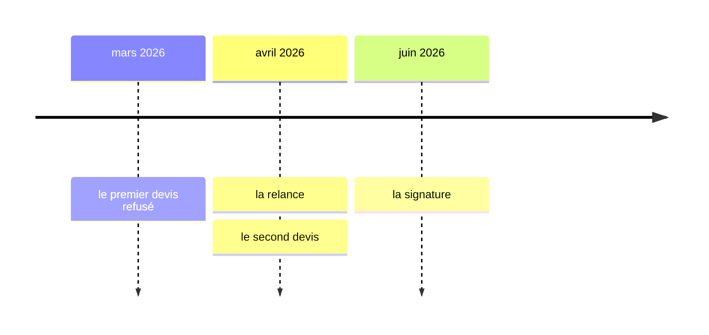
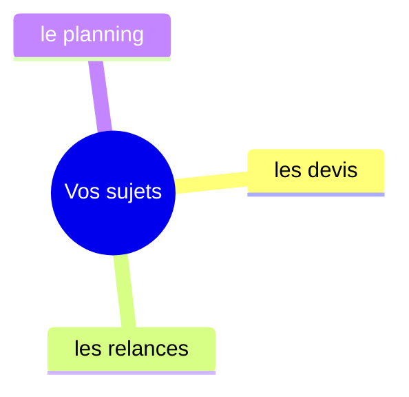
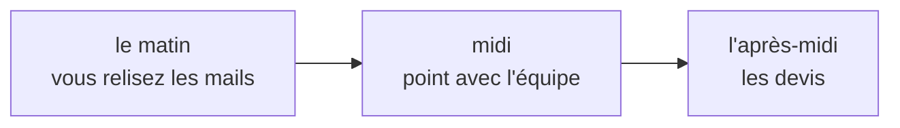

# Votre quotidien de bout en bout
23 octobre 2026 · Camille

## Vos chiffres {chiffres}
Les chiffres que vous avez donnés, chacun dans sa phrase.

- « **Quatre heures** perdues » chaque semaine sur les relances.
- « Une équipe de **douze** personnes » dont trois en télétravail.

**Ce que vous retenez : « on perd du temps avant de produire ».**

## Votre chronologie {frise}
Les épisodes datés que vous avez racontés.

## Vos sujets {carte}

## Une journée type {journee}

## Ce qui a été essayé {avant-apres}
Ce que vous avez tenté et ce que ça a donné.

| Ce que vous avez essayé | Ce que ça a donné |
| --- | --- |
| « un tableau partagé » | « personne ne le met à jour » |
| « un point chaque lundi » | « ça marche quand tout le monde vient » |

> « le point du lundi, c'est le seul truc qui tient »

## Vos outils {tableau}
| Outil | Usage | Qui s'en sert |
| --- | --- | --- |
| Airtable | le planning | la cheffe de projet |
| Notion | les sujets | vous |

## Ce que je comprends de vos cas {lecture}
Lecture de Vauban, pas vos mots.

Pour les devis, vous attendez la réponse sans savoir où elle en est. Vous avez dit : « personne ne me prévient ».

## Ce que nous n'avons pas abordé {reste}
Pour une autre fois :

- « la facturation »
