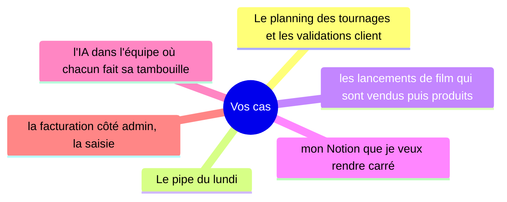
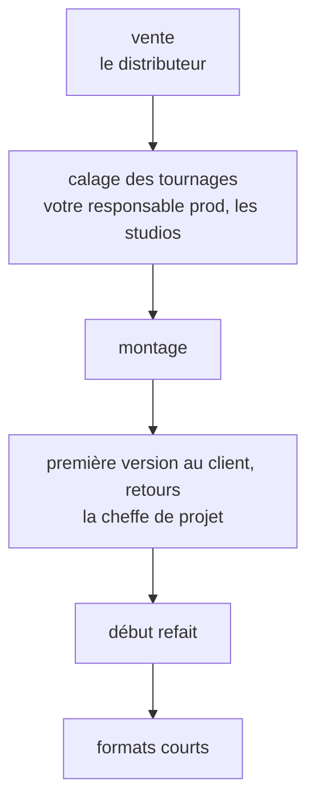
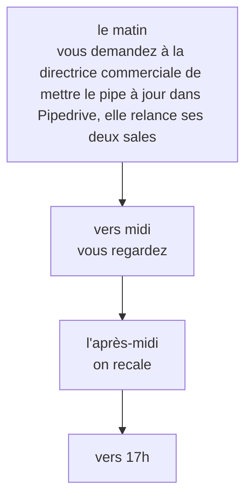

# Vos priorités, vos irritants, ce qui ne va pas
23 octobre 2026 · Martin

## Ce que vous m'avez dit {recit}
Vous êtes fondateur de SensCritique, un média culturel, et vous êtes « une vingtaine ». Six sujets vous occupent. Nous en avons déroulé deux : le planning des tournages avec les validations client, et le pipe du lundi.

> « On continue à perdre des jours à chaque opération, et je reste le pompier. Je peux pas prendre plus d'opérations comme ça. »

---

- « **Trois jours** perdus » sur les validations client.
- « **Deux jours** de boulot pour mon responsable prod » sur le calage des tournages.
- « Ça m'a pris **la moitié** de ma journée, en pointillé. » tous les lundis.

**À côté, ce qui marche : « du premier coup, en cinq minutes ».**

## Vos cas {cas}

### Le planning des tournages et les validations client
Le cas que vous avez déroulé est un lancement de film pour un distributeur. Il a commencé début septembre 2026 et il est toujours en cours : « la diffusion est dans deux semaines ».

---

Deux endroits coincent. D'abord le calage : « ça passe par des mails et un Airtable jamais à jour ». Deux tournages ont été décalés, et vous l'avez appris ainsi : « On me l'a dit à l'oral, en passant, un matin, donc trop tard comme d'hab. » Ensuite les retours du client : « trois retours qui se contredisaient », que la cheffe de projet vous a transférés par mail. « J'ai appelé la cheffe de projet pour voir qui disait quoi. Ensuite j'ai tranché pour la personne qui signe côté distributeur. » Puis le début a été refait.

Cela revient : la fois d'avant, fin août 2026, sur un lancement pour une plateforme, c'était « Même scénario. »

> « c'est ça mon problème de fond, personne me prévient, je dois aller voir moi-même »

---

Pour y répondre, vous avez commencé quelque chose : « j'ai commencé à vouloir tout mettre dans mon Notion, un vrai tableau carré où tout remonte tout seul, je l'ai commencé il y a quelques semaines avec un prompt ».

Si rien ne change : « On continue à perdre des jours à chaque opération, et je reste le pompier. » Si c'était réglé :

> « Je respirerais. Je passerais du temps sur les ventes au lieu de courir après tout le monde, et on dirait oui à des opérations qu'on refuse aujourd'hui. »

### Le pipe du lundi
Le dernier : le lundi 19 octobre 2026, du matin jusqu'à « vers 17h ». « Tous les lundis », et « Ça m'a pris la moitié de ma journée, en pointillé. »

Le matin : « Le matin je demande à la directrice commerciale de mettre le pipe à jour dans Pipedrive, elle relance ses deux sales. » Vers midi, ça coince : « c'est jamais complet », c'est-à-dire « Des deals sans étape, des montants pas à jour. » L'après-midi : « J'ai rappelé la directrice commerciale et j'ai regardé les deals un par un dans Pipedrive. » Vers 17h : « c'est à peu près propre ».

Si rien ne change : « Je continue à perdre la moitié de mon lundi et le pipe reste faux la moitié du temps. » Si c'était réglé : « Je ferais des rendez-vous avec des distributeurs, de la vente. »

## Ce qui marche, et votre assistant {recit}
> « Mon Notion piloté par prompt. Il y a dix jours j'ai réorganisé les sujets par pôle, du premier coup, en cinq minutes. »

C'était vers le 13 octobre 2026, et cela se distingue de vos cas : « J'étais tout seul avec mon assistant, personne à attendre ni à relancer. »

Votre assistant, vous vous en servez tous les jours, mais dans l'équipe : « chacun fait son truc de son côté, la cheffe de projet a son prompt et personne d'autre l'a ». Votre responsable prod s'en sert « un peu, pour ses mails ». Votre dernier usage, le 22 octobre 2026 : « Hier à vélo, je réfléchissais à comment faire remonter les étapes des opérations dans un tableau tout seul. » Ce qui en sort : « Je repars avec un plan », mais « ce qui en sort reste dans la conversation, je le recopie pas dans Notion ».

## Ce que vous voudriez voir plus clair {recit}
> « Voir d'un coup d'œil où en est chaque opération, sans relancer tout le monde. »

Le mardi 20 octobre 2026, « quand le distributeur m'a demandé où en était le film. J'ai dû appeler la cheffe de projet puis le monteur. »

## Ce que je comprends de vos cas {lecture}
Ma lecture, pas vos mots.

Pour le calage des tournages, l'information vous arrive après coup, et c'est à vous d'aller la chercher. Vous avez dit : « personne me prévient, je dois aller voir moi-même ».

Pour le pipe du lundi, vous vérifiez vous-même ce qui devrait déjà être à jour. Vous avez dit : « c'est jamais complet » ; « j'ai regardé les deals un par un dans Pipedrive ».

Ce que vous voulez, c'est savoir où en est chaque opération sans relancer personne. Vous avez dit : « Voir d'un coup d'œil où en est chaque opération, sans relancer tout le monde. »

Votre assistant vous sert quand vous êtes seul avec lui, et ce qu'il produit ne passe pas dans Notion. Vous avez dit : « J'étais tout seul avec mon assistant, personne à attendre ni à relancer. » ; « ce qui en sort reste dans la conversation, je le recopie pas dans Notion ».

## Ce que nous n'avons pas abordé {reste}
Pour une autre fois :

- « les lancements de film qui sont vendus puis produits »
- « mon Notion que je veux rendre carré »
- « l'IA dans l'équipe où chacun fait sa tambouille »
- « la facturation côté admin, la saisie » (« c'est de la ressaisie à la main et ça m'énerve »)
